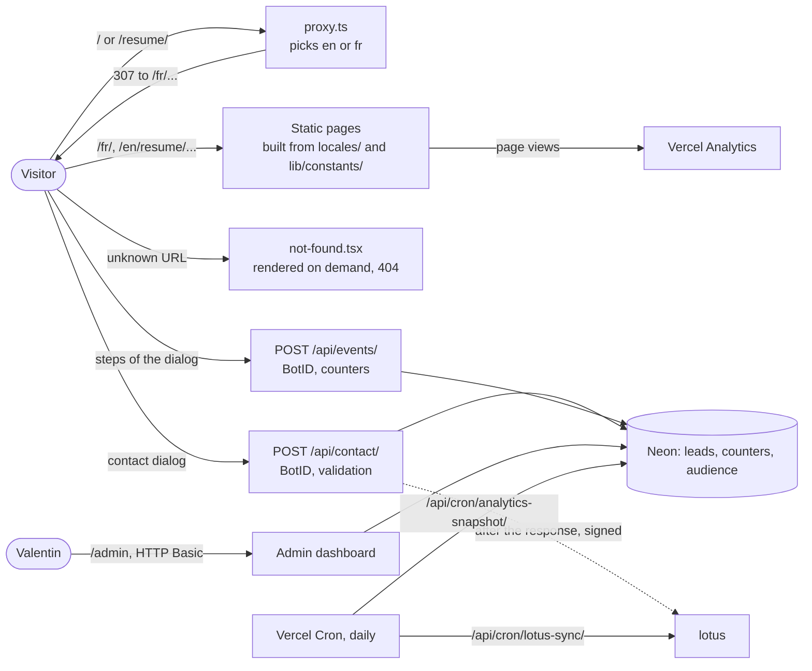

# Architecture overview

**Summary.** The site is a Next.js 16 application (App Router, Turbopack) deployed on
Vercel. Its public pages (home, resume, legal notice, terms of service, and posts written in MDX), each in French
and English, are generated at build time. Five things run on the server: `proxy.ts`
(locale redirect, the gate of the admin area and of protected posts), `POST /api/contact/` (the contact form,
stored in a Neon database), `POST /api/events/` (anonymous counters of the contact form),
`/admin` (the dashboard of leads, conversion and audience figures) and two daily crons:
one copies the audience figures from Vercel to Neon, the other sends again to lotus the
leads it has not confirmed. Each lead is forwarded to lotus, Valentin's private management
app, right after it is stored.

## The system at a glance



## Stack

| Layer        | Choice                                                                                                                        |
| ------------ | ----------------------------------------------------------------------------------------------------------------------------- |
| Framework    | Next.js 16 (App Router), React 19                                                                                             |
| Language     | TypeScript 6, strict                                                                                                          |
| Styling      | Tailwind CSS v4 and shadcn/ui, themed with the Eucalyptus tokens of the design charter ([styling.md](../frontend/styling.md)) |
| Translations | Plain dictionaries, no library ([i18n.md](i18n.md))                                                                           |
| Dates        | `dayjs`                                                                                                                       |
| Fonts        | Geist and Geist Mono, from the `geist` package                                                                                |
| Analytics    | Vercel Analytics                                                                                                              |
| Hosting      | Vercel, deployed on every push to `main` ([runbook](../operations/runbook.md))                                                |

## Folder structure

`app/` holds routing only. Everything else lives in `components/`, `lib/` and `locales/`.

```
app/
  globals.css               Tailwind v4 + the Eucalyptus tokens and global rules
  favicon.ico, apple-icon.tsx  Favicon, and the generated Apple icon
  manifest.ts, robots.ts, sitemap.ts
  [locale]/                 Root segment: every route is under a locale
    layout.tsx              Root layout: <html>, fonts, theme, header, analytics
    page.tsx                Home (ends with its contact footer)
    opengraph-image.tsx     Sharing image, one per locale
    error.tsx               Error boundary (Client Component), translated
    not-found.tsx           Translated 404, rendered inside the layout
    [...rest]/page.tsx      Catch-all that sends unknown URLs to not-found.tsx
    resume/page.tsx         Resume
    resume/print/page.tsx   The resume on one A4 sheet, printed to public/cv-<locale>.pdf
    posts/                  List of posts, a post and its sharing image ([slug]), RSS feed (feed.xml)
    unlock/[slug]/page.tsx  Password form of a protected post, shown by proxy.ts at its URL
    legal/page.tsx          Legal notice and privacy
    cgv/page.tsx            General terms of service (French text in both languages)
  admin/                    Dashboard of leads: own root layout, French only
  api/contact/route.ts      Receives a lead from the contact dialog
  api/events/route.ts       Counts a step of the contact dialog
  api/posts/unlock/route.ts Exchanges the password of a protected post for a signed cookie
  api/cron/                 Scheduled jobs: copy of the audience figures, lotus retry
components/                 One folder per component (header, avatar, breadcrumb,
                            profile-card, changelog-entry, project-card, post-*…)
  ui/                       shadcn/ui components, restyled for the charter
lib/
  i18n/                     Locales, getLocale, getDictionary
  leads/                    Validation and storage of leads
  lotus/                    Forwarding of leads to lotus: config, signed request, retry
  cron/                     Authorization shared by the cron routes
  funnel/                   Counters of the contact dialog: tracking, storage, report
  analytics/                Vercel Web Analytics client, daily snapshot, storage, report
  db/                       Neon client
  admin/                    Authentication, guard and figures of the admin
  posts/                    MDX source reading (reading time, summary), access to protected posts
  models/                   Types: page contents (content.ts), legal documents (legal.ts) and resume data
  constants/                Site data used by the structured data, page registry
  helpers/                  metadata.ts, json-ld.ts, posts.ts, og-fonts.ts
  utils/                    cn.ts
content/posts/              Posts: <slug>/<locale>.mdx
public/posts/               Images of the posts: <slug>/<name>[-jour|-nuit].webp
mdx-components.tsx          The MDX components of a post and how its elements are drawn
locales/                    en.ts, fr.ts: dictionaries
  content/                  en.ts, fr.ts: texts of the home page and the resume
  legal/                    cgv.fr.ts (the terms, French only), notice.fr.ts, notice.en.ts
proxy.ts                    Locale redirect, gate of /admin and of protected posts
instrumentation-client.ts   Routes protected by Vercel BotID
db/                         schema.sql and its setup script
scripts/                    cv-pdf.mjs: prints the resume PDFs
tests/                      unit/, routes/, smoke/: the test suite (Vitest)
vercel.json                 Cron schedule
public/                     Portrait, resume PDFs, security.txt
docs/                       This documentation; redesign/ holds the brief and the charter
```

Import alias: `@/*` points to the repository root. A relative import may reach a sibling
folder (`../appear/appear`); anything further goes through the alias.

## Rendering model

- `app/[locale]/layout.tsx` is the root layout. There is no `app/layout.tsx`, which makes
  `locale` a root parameter readable anywhere on the server ([i18n.md](i18n.md)).
- `generateStaticParams` in the root layout lists the locales, so `/en/`, `/fr/`,
  `/en/resume/` and `/fr/resume/` are prerendered.
- Almost every component is a Server Component. Client Components exist only for
  what needs the browser: the header nav (current path), the theme button, the theme
  provider and the error boundary.
- The catch-all route `[...rest]` is the only dynamic route. It calls `notFound()`, which
  renders `not-found.tsx` inside the layout, in the right language, with a 404 status.
- Durations on the resume ("2 years") are computed at build time. They refresh on the next
  deployment, not by themselves.

## Related pages

- Pages and how to add one: [features/pages.md](../features/pages.md).
- Posts: [features/posts.md](../features/posts.md). Resume PDF: [features/resume-pdf.md](../features/resume-pdf.md).
- Conversion: [features/conversion.md](../features/conversion.md). Lotus: [features/lotus-sync.md](../features/lotus-sync.md).
- Tests: [development/testing.md](../development/testing.md).
- Where the content lives: [content/resume-data.md](../content/resume-data.md).
- Headers and CSP: [security.md](security.md).
