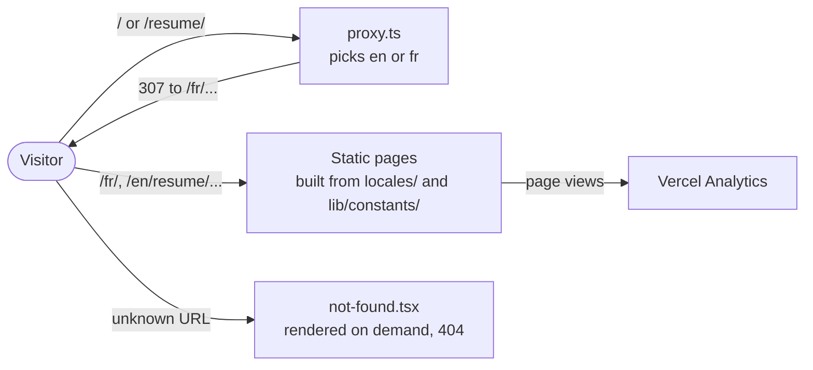

# Architecture overview

**Summary.** The site is a Next.js 16 application (App Router, Turbopack) deployed on
Vercel. It has three pages (home, resume, legal notice), each in English and French. Every
page is generated at build time: there is no database, no form, no API route and no
environment variable. The only code that runs per request is `proxy.ts`, which redirects
URLs that carry no locale.

## The system at a glance



## Stack

| Layer        | Choice                                                                                            |
| ------------ | ------------------------------------------------------------------------------------------------- |
| Framework    | Next.js 16 (App Router), React 19                                                                 |
| Language     | TypeScript 6, strict                                                                              |
| Styling      | Tailwind CSS v4, shadcn/ui on Radix primitives                                                    |
| Translations | Plain dictionaries, no library ([i18n.md](i18n.md))                                               |
| Dates        | `dayjs`                                                                                           |
| Animation    | CSS only: entrance on load and reveal on scroll ([styling.md](../frontend/styling.md#animations)) |
| Analytics    | Vercel Analytics                                                                                  |
| Hosting      | Vercel, deployed on every push to `main` ([runbook](../operations/runbook.md))                    |

## Folder structure

`app/` holds routing only. Everything else lives in `components/`, `lib/` and `locales/`.

```
app/
  globals.css               Tailwind v4 + theme
  manifest.ts, robots.ts, sitemap.ts
  [locale]/                 Root segment: every route is under a locale
    layout.tsx              Root layout: <html>, font, theme, header, footer, analytics
    page.tsx                Home
    error.tsx               Error boundary (Client Component), translated
    not-found.tsx           Translated 404, rendered inside the layout
    [...rest]/page.tsx      Catch-all that sends unknown URLs to not-found.tsx
    resume/
      page.tsx              Resume
      _components/          Resume-only components (private folder, never routed)
    legal/page.tsx          Legal notice and privacy
components/                 Components shared across pages
  ui/                       shadcn/ui components
  icons/                    SVGs as React components
  json-ld/                  The structured data tag of a page
lib/
  i18n/                     Locales, getLocale, getDictionary
  models/                   Types and enums (enums are used as identifiers)
  constants/                Site data, typed by models/
  helpers/                  metadata.ts and json-ld.ts
  utils/                    cn.ts, format-date-difference.ts
locales/                    en.ts, fr.ts: every visible text
proxy.ts                    Locale redirect
public/                     Images
docs/                       This documentation
```

Import alias: `@/*` points to the repository root. A relative import may reach a sibling
folder (`../appear/appear`); anything further goes through the alias.

## Rendering model

- `app/[locale]/layout.tsx` is the root layout. There is no `app/layout.tsx`, which makes
  `locale` a root parameter readable anywhere on the server ([i18n.md](i18n.md)).
- `generateStaticParams` in the root layout lists the locales, so `/en/`, `/fr/`,
  `/en/resume/` and `/fr/resume/` are prerendered.
- Almost every component is a Server Component. Client Components exist only for
  interactivity: the language and theme toggles, the theme provider and the error boundary.
- The catch-all route `[...rest]` is the only dynamic route. It calls `notFound()`, which
  renders `not-found.tsx` inside the layout, in the right language, with a 404 status.
- Durations on the resume ("2 years") are computed at build time. They refresh on the next
  deployment, not by themselves.

## Related pages

- Pages and how to add one: [features/pages.md](../features/pages.md).
- Where the content lives: [content/resume-data.md](../content/resume-data.md).
- Headers and CSP: [security.md](security.md).
