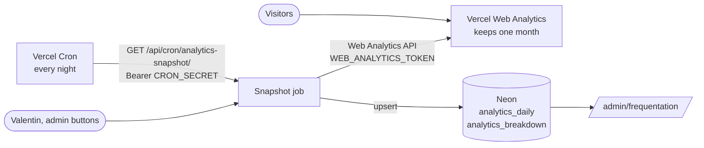

# Audience figures

**Summary.** The site is measured with Vercel Web Analytics, which keeps one month of data
on the free plan. A daily job copies the aggregated figures to the Neon database, where
they are kept with no time limit, and the [admin area](admin.md) reads them from there.
Only anonymous totals are stored: no visitor can be identified from them.

## How it works

## The snapshot

[snapshotAnalytics](../../lib/analytics/snapshot.ts) does two things each time it runs:

1. **Daily totals** of the 30 days Vercel still has (visitors and page views per day), in
   one request, written to `analytics_daily`. A day without a visit is stored as zero.
2. **Breakdowns** by page, referrer, country and device for the last days, one request
   per day and dimension, written to `analytics_breakdown`.

It is idempotent: rows are upserted, so running it twice changes nothing. It never throws:
it answers `ok`, `unconfigured` (no token) or `error`.

| Trigger                          | Days of breakdowns | Why                                                    |
| -------------------------------- | ------------------ | ------------------------------------------------------ |
| Daily cron                       | 3                  | repairs a missed run and catches hits that arrive late |
| "Actualiser" in the admin        | 3                  | same, on demand                                        |
| "Importer 30 jours" in the admin | 30                 | first run, or after a long interruption                |

Days are UTC days. Figures come from the Vercel API
(`GET /v1/query/web-analytics/visits/aggregate`), the same aggregated numbers as the
Vercel dashboard.

## The cron

[vercel.json](../../vercel.json) schedules `GET /api/cron/analytics-snapshot/` every day at
03:15 UTC. Vercel sends `Authorization: Bearer <CRON_SECRET>`; the route compares it in
constant time and is closed without the variable. The check is `isCronAuthorized`
([lib/cron/auth.ts](../../lib/cron/auth.ts)), shared with the
[lotus retry](lotus-sync.md#the-daily-retry): a new cron route calls it first.

## Variables

| Variable                   | Use                                                                                      |
| -------------------------- | ---------------------------------------------------------------------------------------- |
| `WEB_ANALYTICS_TOKEN`      | Vercel access token (Account Settings, Tokens), scoped to the project's team if possible |
| `WEB_ANALYTICS_PROJECT_ID` | project id; optional on Vercel, which provides `VERCEL_PROJECT_ID`                       |
| `WEB_ANALYTICS_TEAM_ID`    | team id, only if the project belongs to a team and the token is not scoped to it         |
| `CRON_SECRET`              | secret of the cron routes                                                                |
| `WEB_ANALYTICS_API_URL`    | test hook only: points the client to a stand-in API                                      |

Without the token the job does nothing and the admin says the daily copy is inactive.

## In the admin

The audience page, [/admin/frequentation/](admin.md#audience-and-conversion-adminfrequentation),
reads the stored figures through [loadTrafficReport](../../lib/analytics/report.ts); the
leads page shows a recap of the last 30 days with a link to it:

- a period filter (`?periode=30`, `90`, `365` or `all`);
- page views and visits over the period, and how far back the history goes;
- a chart of page views, one bar per day up to 90 days, one per month beyond;
- the top pages, referrers, countries and devices.

**Visits are not unique visitors.** Vercel gives unique visitors per day; over a period
the admin adds the days up, so someone who comes on two days counts twice. The label says
so. Unique visitors over a long period cannot be rebuilt from daily totals.

## State and limits

- **In production since 2026-10-11.** The first snapshot stored 30 days of daily totals and
  the breakdowns of the last 3 days, read from the real Vercel API.
- **Asking for one day.** The API returns nothing when `since` and `until` are the same
  date. The snapshot tries three forms on a day that had traffic (`DAY_RANGES` in
  `lib/analytics/vercel.ts`) and keeps the first that returns data; in production it is
  `timestamps`, the first to the last millisecond of the day. The cron answer reports it
  (`dayRange`) with the number of rows written (`breakdownRows`).
- Before the first "Importer 30 jours", breakdowns exist only from the first snapshot on;
  the daily totals go back a month.
- History starts on the day of the first successful snapshot, minus the 30 days Vercel
  still had.
- Also verified against a stand-in API with the in-memory store: cron authorisation,
  idempotence, admin display.
- If Vercel changes the response shape, `lib/analytics/vercel.ts` is the only file to adapt.
