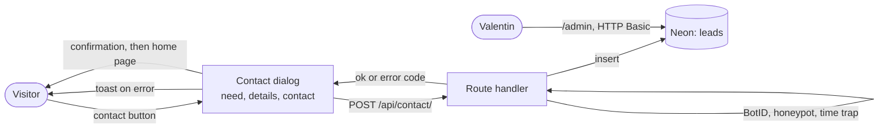

# Contact form

**Summary.** Every "Prendre contact" button opens a dialog instead of the mail client.
The dialog asks three short questions, sends the answers to `POST /api/contact/`, which
stores them in Neon, and ends on a confirmation screen. Every error, on the client or
from the server, is shown as a toast. Leads are read in the [admin area](admin.md).

## The path of a lead

## The dialog

[ContactDialogProvider](../../components/contact/contact-dialog.tsx) is mounted once in the
root layout. [ContactTriggerComponent](../../components/contact/contact-trigger.tsx) opens
it: the primary button of the home page, the large link of its footer, and the secondary
button of the resume. A trigger is a real `mailto:` link, so it still works without
JavaScript.

| Step       | Fields                              | Rule checked before moving on |
| ---------- | ----------------------------------- | ----------------------------- |
| 1. Need    | one of `LEAD_NEEDS`                 | a choice is required          |
| 2. Details | message, preferred start (optional) | at least 10 characters        |
| 3. Contact | name, e-mail, company (optional)    | a name, a valid e-mail        |
| Success    | recap of the request                | —                             |

Closing the dialog after a success sends the visitor to the home page. From then on the
contact buttons are replaced by a confirmation line ("Message envoyé…") with a link to
write again. This is remembered in `localStorage` (`contact-sent-at`), read through
`useSyncExternalStore`, so nothing differs between the server and the first client render.

The dialog is built with the shadcn components `Dialog`, `RadioGroup`, `Input`,
`Textarea`, `Label`, `Button` and `Card`.

## Errors are toasts

Any failure calls `toast.error` (shadcn `Sonner`, mounted in the root layout) with a text
from `contact.errors` in the dictionaries. There is no inline error message; the field at
fault also gets `aria-invalid`.

| Code                                                                   | When                                                                  |
| ---------------------------------------------------------------------- | --------------------------------------------------------------------- |
| `need_required`, `message_too_short`, `name_required`, `invalid_email` | a step is incomplete (checked in the dialog, and again by the server) |
| `invalid_body`                                                         | the request is not a JSON object                                      |
| `forbidden`                                                            | Vercel BotID classified the request as a bot                          |
| `unavailable`                                                          | the database is not configured (`DATABASE_URL` missing)               |
| `server_error`                                                         | the insert failed                                                     |
| `network`                                                              | the request never reached the server (client only)                    |

A new code needs its text in both locale files: the type `ContactErrorCode` and the
dictionary keep them in line.

## API contract

`POST /api/contact/` (with the trailing slash), JSON body:

| Field       | Type            | Notes                                       |
| ----------- | --------------- | ------------------------------------------- |
| `need`      | string          | one of `LEAD_NEEDS`                         |
| `timeline`  | string or empty | one of `LEAD_TIMELINES`                     |
| `message`   | string          | 10 to 3000 characters                       |
| `name`      | string          | up to 80 characters                         |
| `email`     | string          | lowercased, validated                       |
| `company`   | string or empty | up to 120 characters                        |
| `locale`    | string          | `fr` or `en`                                |
| `website`   | string          | honeypot: must be empty                     |
| `startedAt` | number          | time the dialog was opened, in milliseconds |

Answers: `200 { "ok": true }`, or `{ "error": "<code>" }` with status 400, 403, 500 or 503.

## Anti-spam

Three filters, in this order, as on the brut project:

1. **Vercel BotID** (`checkBotId`), only on Vercel: it needs a token the platform sets.
   The route is declared in [instrumentation-client.ts](../../instrumentation-client.ts)
   and `withBotId` wraps the Next.js config.
2. **Honeypot:** a `website` field hidden from people. Filled means bot.
3. **Time trap:** a form sent less than 3 seconds after the dialog opened, or more than a
   day after, is dropped.

For 2 and 3 the answer is `{ "ok": true }`, so that a bot learns nothing. There is no rate
limit yet.

## Rules

- A form is sent with `fetch`, never as a native HTML post: BotID would not apply.
- Every protected route is declared in `initBotId` and calls `checkBotId()`.
- SQL goes through the `sql` template tag of the Neon driver, never through concatenation.
- Never log a message, a name or an e-mail address.
- The values of `LEAD_NEEDS`, `LEAD_TIMELINES` and `LEAD_STATUSES` are stored: add one,
  never rename one.
- Any change to what is collected updates the [legal page](pages.md) in both languages.
