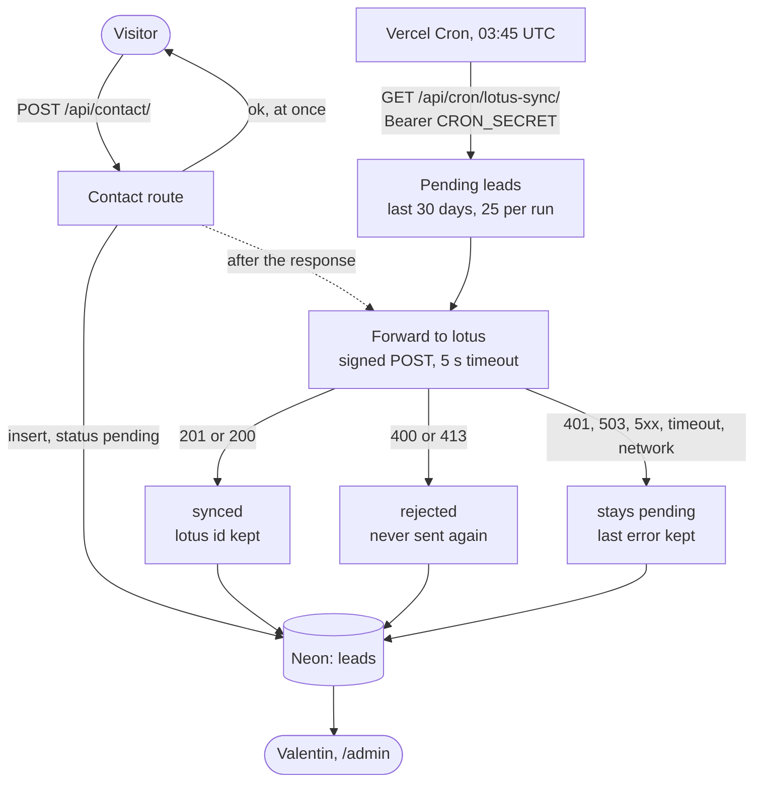

# Lotus sync

**Summary.** Once a lead is stored in Neon, the site sends it to lotus, Valentin's private
management app, through a signed webhook. The answer to the visitor never depends on
lotus and is never delayed by it. Each lead carries a **sync status** (`pending`, `synced`,
`rejected`) shown in the admin: `synced` means lotus answered that it has the lead. A
daily job sends again what lotus has not confirmed. Without its two environment variables
nothing is sent and the site behaves as before.

The contract is specified in the lotus repository, `docs/integration-site.md` (in French),
which is authoritative for both sides. This page is how this site applies it.

## Flow

## Configuration

| Variable               | Value                                                                |
| ---------------------- | -------------------------------------------------------------------- |
| `LOTUS_WEBHOOK_URL`    | `https://<lotus domain>/api/webhooks/leads`                          |
| `LOTUS_WEBHOOK_SECRET` | the shared secret, the same value as `LEADS_WEBHOOK_SECRET` in lotus |
| `CRON_SECRET`          | already used by the audience figures; protects the daily job         |

Forwarding is decided by `getLotusState()` ([config.ts](../../lib/lotus/config.ts)), and
the admin shows the result above the table of leads:

| State          | When                                                    | Effect          |
| -------------- | ------------------------------------------------------- | --------------- |
| `active`       | both variables set, HTTPS URL (or HTTP to this machine) | leads are sent  |
| `unconfigured` | one of the two variables is missing                     | nothing is sent |
| `invalid`      | the URL is not a URL, or plain HTTP to a remote host    | nothing is sent |
| `blocked`      | leads are kept in memory and the URL is not a local one | nothing is sent |

`blocked` is a guard: with the in-memory store, ids restart at 1 with the server, so
`site-1` sent to the real lotus would be taken for a duplicate of a real lead. **Never
point a local or preview build at the production lotus**; this guard is the last line, not
a reason to try.

## The request

`POST ${LOTUS_WEBHOOK_URL}`, JSON body in UTF-8, built by `buildLotusPayload` and sent by
`forwardLead` ([forward.ts](../../lib/lotus/forward.ts)).

| Header              | Value                                                                            |
| ------------------- | -------------------------------------------------------------------------------- |
| `content-type`      | `application/json`                                                               |
| `x-lotus-timestamp` | time of sending, Unix seconds                                                    |
| `x-lotus-signature` | `sha256=` + hex HMAC SHA-256 of `<timestamp>.<body>` with `LOTUS_WEBHOOK_SECRET` |

The body is serialised once: the string that is signed is the string that is sent. The
timestamp is computed again at each attempt, since lotus refuses a gap of more than five
minutes. `signLotusBody` is checked against the test vector of the contract in
[lotus-forward.test.ts](../../tests/unit/lotus-forward.test.ts).

| Field                      | Value                                                                            |
| -------------------------- | -------------------------------------------------------------------------------- |
| `externalId`               | `site-<lead.id>`: the idempotency key                                            |
| `name`, `email`, `message` | the same fields of the lead                                                      |
| `company`                  | left out when empty                                                              |
| `need`                     | the **French label** of the need (`contact.need.options` in `locales/fr.ts`)     |
| `timeline`                 | the French label of the timeline, left out when empty                            |
| `locale`                   | `fr` or `en`: the language to answer the visitor in                              |
| `referrer`                 | `lead.source`, left out when empty                                               |
| `submittedAt`              | `lead.createdAt` (ISO 8601): a lead sent a day late keeps its real date in lotus |

Labels are French whatever the language of the visitor: lotus is a French interface and
does not know the codes of this site. **Never sent:** the IP address, the user agent, the
honeypot, and the follow-up kept in the admin (status, notes, amount, follow-up date).

One limit differs: this site accepts an e-mail address of up to 254 characters, lotus up
to 200. A longer address would be `rejected` (`http_400`) and show as such in the admin.

## Answers of lotus

| Answer                             | Outcome    | What the site does                                            |
| ---------------------------------- | ---------- | ------------------------------------------------------------- |
| `201 { id }`                       | `synced`   | keeps the id and the date                                     |
| `200 { id, duplicate: true }`      | `synced`   | the same: lotus already had it                                |
| `400`, `413`                       | `rejected` | a defect of the contract: records the code, never sends again |
| `401`, `503`, `5xx`, anything else | `pending`  | records the code; the daily job sends again                   |
| timeout (5 s), network error       | `pending`  | records `timeout` or `network`                                |

## Sync status of a lead

Stored in `leads` ([schema.md](../database/schema.md#leads)), in the `Lead` type as
`LeadSync`:

| Column               | Meaning                                                                                                                   |
| -------------------- | ------------------------------------------------------------------------------------------------------------------------- |
| `lotus_status`       | `pending` (default), `synced` or `rejected`. Stored: never rename a value.                                                |
| `lotus_lead_id`      | the id lotus gave                                                                                                         |
| `lotus_synced_at`    | when lotus confirmed                                                                                                      |
| `lotus_error`        | code of the **last failed attempt** (`http_503`, `timeout`, `network`…), cleared on confirmation. Never any lead content. |
| `lotus_attempts`     | number of attempts                                                                                                        |
| `lotus_attempted_at` | date of the last attempt                                                                                                  |

`recordSync` never lets a failure undo a confirmation: the forward that follows the form
and the daily job can cross each other.

In the admin, each row shows the state in words under its date (`describeSync` in
[labels.ts](../../app/admin/labels.ts)):

| Shown                                        | Meaning                                                             |
| -------------------------------------------- | ------------------------------------------------------------------- |
| `● lotus · transmis le 12/10`                | lotus confirmed                                                     |
| `○ lotus · en attente`                       | not tried yet (forwarding off, or just received)                    |
| `○ lotus · en attente · http_503 · 2 essais` | tried, lotus did not confirm; will be sent again                    |
| `○ lotus · refusé · http_400`                | refused for good: see [the runbook](../operations/runbook.md#lotus) |
| `○ lotus · non transmis · plus de 30 jours`  | pending and too old for the daily job: it will not leave by itself  |

The last two are in the text colour and bold: they need a look. A line above the table
gives the state of forwarding and the count per state. The CSV export has the columns
`lotus`, `lotus_id` and `lotus_erreur`.

## The daily retry

`GET /api/cron/lotus-sync/` runs every day at 03:45 UTC (`vercel.json`), behind
`CRON_SECRET` like the other cron route: both use `isCronAuthorized`
([lib/cron/auth.ts](../../lib/cron/auth.ts)). It calls `syncPendingLeads`
([sync.ts](../../lib/lotus/sync.ts)):

- leads with `lotus_status = 'pending'`, created in the last **30 days**, oldest first,
  **25** at most per run;
- the run stops after **3 unavailable answers in a row** (lotus is down: no point in
  waiting 5 seconds for each of the others) or after 40 seconds, well within the 60
  seconds of the function;
- it answers with counts only: `{ status, synced, rejected, pending, skipped }`.

On its first run it also forwards the leads received before this feature, if they are
less than 30 days old: that is intended.

## Rules

- The visitor's answer never depends on lotus. Forwarding runs in `after()`, once the
  response is sent, and `syncLead` never throws.
- Logs carry the lead id, the outcome and the code. Never a name, an address or a message.
- `externalId` makes sending twice harmless; nothing else does. Never change its format.
- A change to what is sent updates the contract in the lotus repository first, then this
  page, the tests and the [legal page](pages.md#legal-notice-and-privacy-localelegal).
- Deleting a lead in the admin does not delete it in lotus, and the reverse.

## How to verify

- `npm test`: the signature against the test vector, the payload, every answer of lotus,
  the retry rules, the guard.
- `npm run build && npm run test:smoke`: the built site, with a stand-in for lotus
  ([lotus-stub.ts](../../tests/smoke/lotus-stub.ts)) that checks the signature and the
  timestamp as lotus does. It covers: forwarded right after the form; lotus down, then
  sent by the daily job; answer lost, then sent again without a duplicate.
- With the real lotus on this machine: run lotus on `http://localhost:3000` with
  `LEADS_WEBHOOK_SECRET` set, start this site on another port with
  `LOTUS_WEBHOOK_URL=http://localhost:3000/api/webhooks/leads` and the same secret, send
  the form, and look for the lead in lotus (`/leads`, column "nouveau") with its need,
  start date, language and origin.
- In production: send the form, then look at the row in `/admin`.

## State and limits

- The end-to-end check against the real lotus has not been run (2026-10-12): only against
  the stand-in, written from the contract and from the reception code of lotus.
- The legal page does not mention lotus yet: the wording was proposed to Valentin on
  2026-10-12 and waits for his approval. Apply it (both languages, `updatedAt` of `legal`
  in `PAGES`) **before** setting the two variables in production.
- No button sends a lead again by hand. A `rejected` or too old lead is handled in the
  database: see [the runbook](../operations/runbook.md#lotus).
