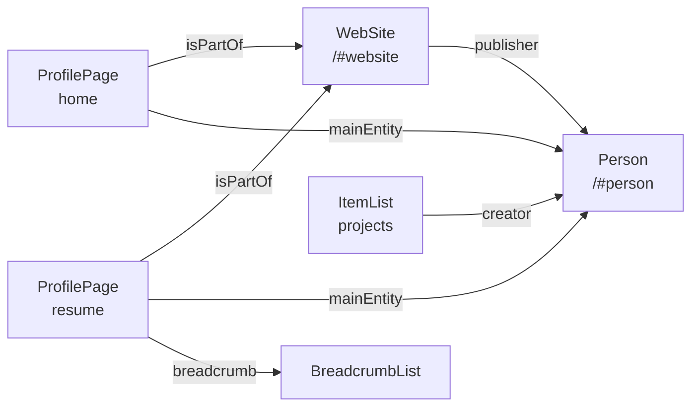

# SEO and structured data

**Summary.** Each page exports its meta tags through one helper and emits one JSON-LD
graph. Both are generated from the page registry, the resume data and the dictionary of
the current locale, so they always match what the page shows. Nothing is written by hand.

## Meta tags

`getPageMetadata("<page>")` in [lib/helpers/metadata.ts](../../lib/helpers/metadata.ts)
returns, for the current locale:

- the translated title and description (`metadata.*`, `resume.metadata.*`,
  `legal.metadata.*`). Keep descriptions under 155 characters: search engines cut the rest;
- the canonical URL and the `hreflang` alternates of every locale, plus `x-default`;
- the Open Graph data (URL, site name, locale, portrait), and a Twitter card of type
  `summary`, the one made for a square image.

Every page exports it: `export const generateMetadata = () => getPageMetadata("home")`.

The canonical host is `https://www.valentinbourreau.com`, the one production serves. It is
set once, in `SITE_URL` ([site.ts](../../lib/constants/site.ts)).

## Sitemap, robots, manifest

- [app/sitemap.ts](../../app/sitemap.ts) is generated from `PAGES` and `LOCALES`: one entry
  per page in the default locale, with the other locales as alternates. `lastModified` is
  the `updatedAt` of the page, not the build date.
- [app/robots.ts](../../app/robots.ts) allows everything and points to the sitemap.
- [app/manifest.ts](../../app/manifest.ts) declares the name and the icon.

## Structured data (JSON-LD)

`<JsonLdComponent page="…" />` renders one `<script type="application/ld+json">` holding a
`@graph`, built by `getPageJsonLd(page)` in
[lib/helpers/json-ld.ts](../../lib/helpers/json-ld.ts) and typed with `schema-dts`.

| Page   | Nodes                                                                                     |
| ------ | ----------------------------------------------------------------------------------------- |
| Home   | `WebSite` (site name), `ProfilePage`, `Person` (summary), `ItemList` of personal projects |
| Resume | `ProfilePage`, `Person` (full), `BreadcrumbList`                                          |
| Legal  | `WebPage`, `BreadcrumbList`                                                               |

The `Person` node carries:

- **Summary (both pages):** name, portrait, job title, description, e-mail, city, `sameAs`
  (GitHub, Dribbble, Behance, LinkedIn), `knowsAbout` (from `skills.ts`), `knowsLanguage`,
  and `worksFor` with the current role.
- **Full (resume only):** `alumniOf` with every past role (name, start and end dates,
  organisation) and the schools, and `hasCredential` with the qualifications.

### Rules

Taken from Google's documentation on
[profile pages](https://developers.google.com/search/docs/appearance/structured-data/profile-page),
[site names](https://developers.google.com/search/docs/appearance/site-names) and
[breadcrumbs](https://developers.google.com/search/docs/appearance/structured-data/breadcrumb).

- Describe only what is visible on the page.
- One `Person` (`…/#person`) and one `WebSite` (`…/#website`) for the whole site. Other
  nodes point to them with `{ "@id": … }` instead of repeating them.
- `WebSite` is emitted on the home page only, which is where Google reads the site name.
- A page about Valentin is a `ProfilePage` with `mainEntity` set to the person
  (`getWebPage(page, "ProfilePage", …)`); the legal page is a plain `WebPage`. A page
  about something else takes the type of its content (`BlogPosting` for a post,
  `CollectionPage` for a list), with `author` pointing to the person.
- Every page except the home page gets a `BreadcrumbList` (Google needs at least two items).
- `dateModified` is the `updatedAt` of the page in `PAGES`. Bump it when the content of the
  page changes, and only then.
- `<` is escaped in the serialised JSON, as the Next.js JSON-LD guide requires.

### Checking

- Before deployment: paste the built page into the
  [Schema Markup Validator](https://validator.schema.org/).
- After deployment: run Google's
  [Rich Results Test](https://search.google.com/test/rich-results) on the live URL.

On 2026-10-10 the validator reported no error and no warning on the home page and the resume. The Rich
Results Test has not been run yet.
