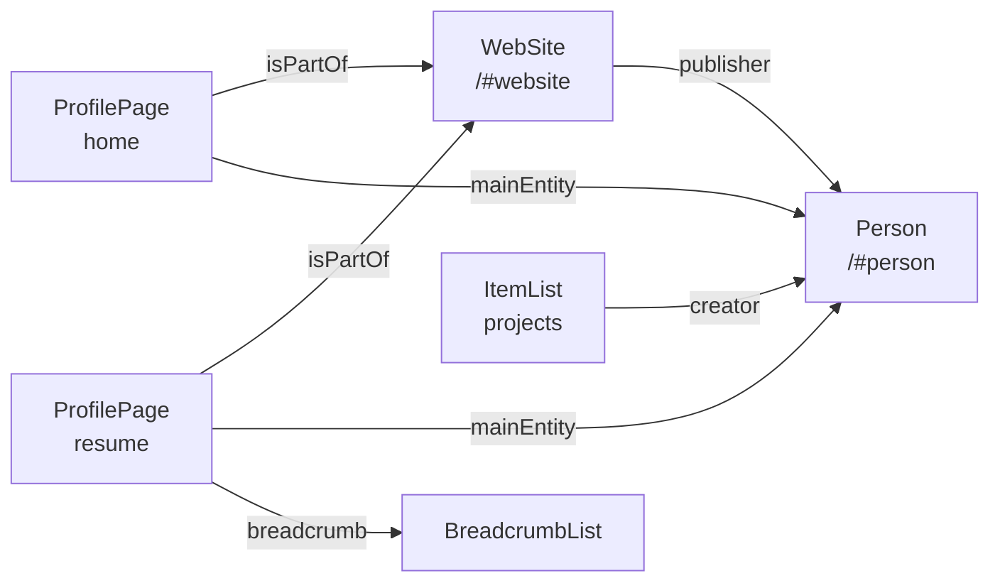

# SEO and structured data

**Summary.** Each page exports its meta tags through one helper and emits one JSON-LD
graph. Both are generated from the page registry, the resume data and the dictionary of
the current locale, so they always match what the page shows. Nothing is written by hand.

## Meta tags

`getPageMetadata("<page>")` in [lib/helpers/metadata.ts](../../lib/helpers/metadata.ts)
returns, for the current locale:

- the translated title and description (`metadata.*`, `resume.metadata.*`,
  `legal.metadata.*`). Keep descriptions under 155 characters: search engines cut the rest;
- the canonical URL and the `hreflang` alternates of every locale, plus `x-default`;
- the Open Graph data (URL, site name, locale) and a `summary_large_image` Twitter card.
  The image itself comes from the file convention below.

Every page exports it: `export const generateMetadata = () => getPageMetadata("home")`.

The canonical host is `https://www.valentinbourreau.com`, the one production serves. It is
set once, in `SITE_URL` ([site.ts](../../lib/constants/site.ts)).

## Sitemap, robots, manifest

- [app/sitemap.ts](../../app/sitemap.ts) is generated from `PAGES` and `LOCALES`: one entry
  per page and per locale. Each entry lists every language version of the page, itself
  included, plus `x-default`, as search engines expect for `hreflang` in a sitemap.
  `lastModified` is the `updatedAt` of the page, not the build date; `priority` and
  `changeFrequency` also come from `PAGES`. A new page appears there by itself.
- [app/robots.ts](../../app/robots.ts) allows everything, points to the sitemap and declares
  the canonical host. Nothing on the site is private, so there is no `Disallow` rule.
- [app/manifest.ts](../../app/manifest.ts) declares the name, the colours and the icons.

Posts are added after the pages: one entry per published public post and per language it
is written in, with only those languages as alternates, `lastModified` set to the post's
`updatedAt`, and its cover then the body images named in the registry (`images`) as
image entries (`<image:loc>`, absolute URLs). The list of
posts is listed only in the languages that have a published post. Drafts and protected
posts never appear, not even on a preview deployment. Each language also has an RSS
feed, `/[locale]/posts/feed.xml`, declared by the pages of the posts section: the lead
as description, one `<category>` per tag.

`/[locale]/resume/print/` is `noindex` and is not in the sitemap.

## Sharing image and icons

Both are generated at build time with `next/og`, in Geist, from the font files of the
`geist` package ([og-fonts.ts](../../lib/helpers/og-fonts.ts)). Their look is set by the
design charter.

- [app/[locale]/opengraph-image.tsx](../../app/[locale]/opengraph-image.tsx): 1200 × 630,
  day mode, one per locale: breadcrumb, title, status line.
- [app/[locale]/posts/[slug]/opengraph-image.tsx](../../app/[locale]/posts/[slug]/opengraph-image.tsx):
  one per post, same frame: `~/articles/<slug>`, the title, the project. A protected
  post shows neither its title nor its project. Served at
  `/<locale>/posts/<slug>/opengraph-image/` (the URL the structured data uses; the meta
  tag carries a cache hash and goes through the trailing-slash redirect).
- [app/favicon.ico](../../app/favicon.ico): the favicon Valentin drew before the redesign.
  He prefers it to a generated one: do not replace it.
- [app/apple-icon.tsx](../../app/apple-icon.tsx): the letter `v` in Geist Bold, night
  colours, for iOS home screens. `proxy.ts` lets `/apple-icon` through; a new generated
  file at the root needs the same exception in its `matcher`.

## Structured data (JSON-LD)

`<JsonLdComponent page="…" />` (or `post={…}` for a [post](posts.md)) renders one
`<script type="application/ld+json">` holding a `@graph`, built by `getPageJsonLd(page)` in
[lib/helpers/json-ld.ts](../../lib/helpers/json-ld.ts) and typed with `schema-dts`. The
graph of a page in a given language is `getPageGraph(page, locale)`: it reads the
dictionaries directly, so a test builds every page in every language.

| Page   | Nodes                                                                                                                                    |
| ------ | ---------------------------------------------------------------------------------------------------------------------------------------- |
| Home   | `WebSite` (site name), `ProfilePage`, `Person` (summary), `ItemList` of personal projects; `hasPart` → `Blog` when the posts block shows |
| Resume | `ProfilePage`, `Person` (full), `BreadcrumbList`                                                                                         |
| Legal  | `WebPage`, `BreadcrumbList`                                                                                                              |
| Posts  | `CollectionPage`, `Blog` (`…/posts/#blog`) listing a summary `BlogPosting` per listed post, `BreadcrumbList`                             |
| A post | `WebPage`, `BlogPosting` (full), `BreadcrumbList` Home › Articles › title                                                                |

The `Person` node carries:

- **Summary (both pages):** name, portrait, job title, description, e-mail, city, `sameAs`
  (GitHub, Dribbble, Behance, LinkedIn), `knowsAbout` (from `skills.ts`) and
  `knowsLanguage`. No `worksFor` while freelance: there is no current employer.
- **Full (resume only):** `alumniOf` with every past role (name, start and end dates,
  organisation) and the schools, and `hasCredential` with the qualifications.

A full `BlogPosting` (`getPostJsonLd(post)`, the same function for every post, so posts
are not listed in `PAGES` one by one) carries `headline`, `description`, `abstract` (the
lead), both dates, `inLanguage`, `author` and `publisher` (the person's `@id`),
`mainEntityOfPage`, `isPartOf` (the blog), `image` (the cover as an `ImageObject` with
its size and caption, then the 1200 × 630 sharing image, then the body images named in
the registry with their size), `articleSection` (« Projets » /
"Projects"), `keywords` (the tags), `wordCount` and `timeRequired` (`PT10M`), both
computed from the MDX source at build time, and `about`: the project as a
`MobileApplication` or `WebApplication` (with `applicationCategory` and
`operatingSystem`) or a `WebSite` (with its `url`). The trail is referenced from the
`WebPage` (`breadcrumb`), where schema.org defines it, not from the `BlogPosting`.

In list form (`summary`, inside the `Blog`) a post only has its URL, headline,
description, dates, language and author. The home page references the `Blog` by `@id`
and never repeats a `BlogPosting`.

A test ([tests/unit/json-ld.test.ts](../../tests/unit/json-ld.test.ts)) builds every page
and every post in every language where it exists and checks that the graph survives a
JSON round trip, holds no undefined, null or empty value, and that every URL is
absolute. The smoke tests parse the JSON-LD of the list and of each post.

### Rules

Taken from Google's documentation on
[profile pages](https://developers.google.com/search/docs/appearance/structured-data/profile-page),
[site names](https://developers.google.com/search/docs/appearance/site-names) and
[breadcrumbs](https://developers.google.com/search/docs/appearance/structured-data/breadcrumb).

- Describe only what is visible on the page.
- One `Person` (`…/#person`) and one `WebSite` (`…/#website`) for the whole site. Other
  nodes point to them with `{ "@id": … }` instead of repeating them.
- `WebSite` is emitted on the home page only, which is where Google reads the site name.
- A page about Valentin is a `ProfilePage` with `mainEntity` set to the person
  (`getWebPage(page, "ProfilePage", …)`); the legal page is a plain `WebPage`. A page
  about something else takes the type of its content (`BlogPosting` for a post,
  `CollectionPage` for a list), with `author` pointing to the person.
- Every page except the home page gets a `BreadcrumbList` (Google needs at least two items).
- `dateModified` is the `updatedAt` of the page in `PAGES`. Bump it when the content of the
  page changes, and only then.
- `<` is escaped in the serialised JSON, as the Next.js JSON-LD guide requires.

### Checking

- Before deployment: paste the built page into the
  [Schema Markup Validator](https://validator.schema.org/).
- After deployment: run Google's
  [Rich Results Test](https://search.google.com/test/rich-results) on the live URL.

On 2026-10-10 the validator reported no error and no warning on the home page and the resume. The Rich
Results Test has not been run yet.
